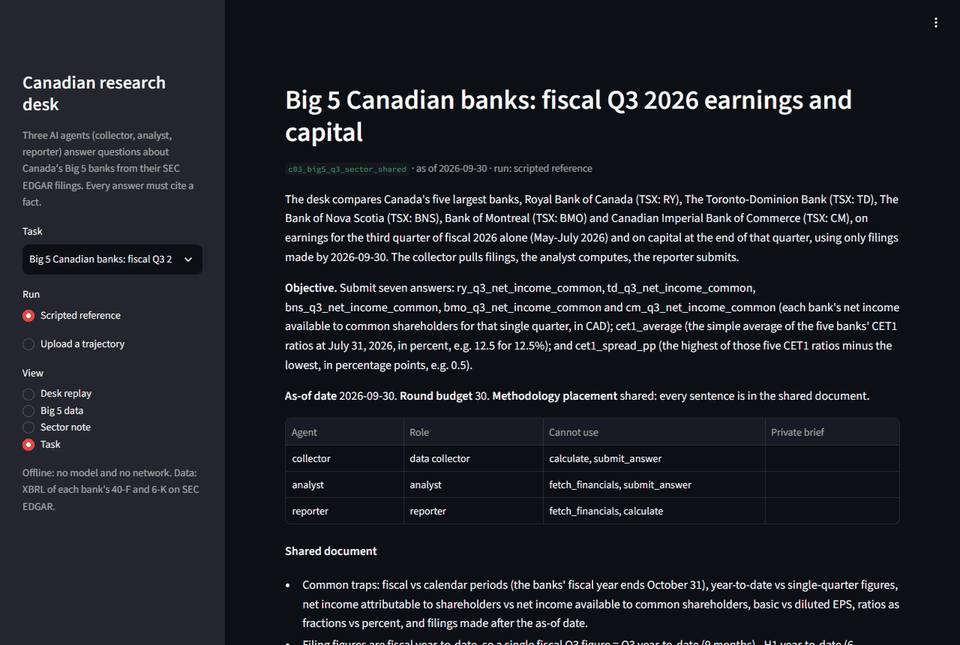
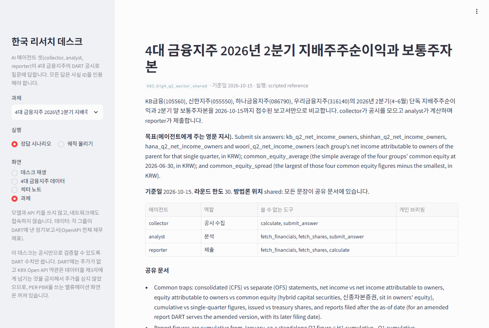

# AgentWorld-Lite

English · [한국어](README.ko.md)

A lightweight, pip-installable testbed for **long-horizon multi-agent LLM collaboration**, based on two September 2026 papers:

- **[AgentWorld](https://arxiv.org/abs/2609.31590)** (Shu et al.) — how to *measure* collaboration: agents with asymmetric roles cooperate through chat only, and the **Causal Collaboration Effectiveness (CCE)** metric counts how much of a team's effort causally led to success.
- **[AutoGym](https://arxiv.org/abs/2609.22592)** (Noronha et al.) — how to *generate* verifiable tasks: fix the solution blueprint first, then build the environment and verifiers around it. This project borrows that idea for its task generator.

> **Unofficial.** Not affiliated with the authors of either paper. The official AgentWorld benchmark (game engine, 100 + 200 tasks, reference harness and evaluation tools) is at **[openagents-org/agentworld](https://github.com/openagents-org/agentworld)** and needs its own game server. This project is a separate, much smaller grid simulator that follows the same protocol and runs with `pip` alone, for quick experiments on task design and communication. Numbers are **not comparable** with the paper; use it for relative comparisons between models and for failure analysis.

## What's inside

- **Simulator**: 64×48 tile world (forest, mines, lake, village, dungeon), ~40 items, recipes with crafting stations, combat, NPC shops, buildable structures, aggressive mobs.
- **13 high-level tools** (`move_to`, `attack_entity`, `harvest_resource`, `craft_item`, `transfer_items`, `send_chat`, …). Each call wraps a multi-step mechanic, as in the paper.
- **Protocol**: turn-based round-robin, one tool call per agent per round, black-box agents with chat as the only shared channel. Ablations: `no_comm`, `no_docs`, `whitebox` (oracle-communication proxy), `random_spawn`.
- **9 hand-built tasks** covering all 8 AgentWorld categories (combat, crafting, gathering, trading, exploration, survival, construction, coordination), 3–6 agents each. Every task ships a reference solution that the test suite replays.
- **Metrics**: success rate, partial success rate, **CCE / per-agent contribution (PAC)** with two judges (the paper's backward-tracing LLM judge, plus a deterministic rule-based judge for free runs and judge-agreement checks), and the paper's 6-way **communication failure taxonomy**.
- **Blueprint-first task generator** (idea borrowed from AutoGym, adapted to multi-agent play): sample generation parameters, build the solution DAG (who gathers, crafts and hands what to whom), materialize a task, certify it by running the reference solution, repair failures, set the round budget. No LLM calls; **~93% yield**.
- **Model backends**: Claude (Anthropic API) and **Ollama** (free local models, or Ollama cloud models such as `gemma4:cloud`).
- **Finance domain**: the same protocol on a research desk that fetches filings, computes valuation metrics and submits cited answers. Korean DART disclosures (a synthetic company and **real filings of Korea's four financial holding companies**) and **real filings of Canada's Big 5 banks** (SEDAR+ annual and interim reports, read from their SEC EDGAR copies), with a cited sector note generated from a finished run (see below).
- **191 tests**, none of which call an API.

## Quick start (no API key)

```bash
pip install -e ".[dev]"
```

```bash
python -m agentworld_lite validate
```

```bash
python -m agentworld_lite run --agent scripted --out runs/oracle
```

```bash
python -m agentworld_lite run --agent random --settings full no_comm --seeds 1 2 3 --out runs/random
```

```bash
python -m agentworld_lite evaluate --run runs/oracle --judge rule
```

```bash
python -m agentworld_lite report --runs runs/oracle runs/random --out reports/baseline.md --graphs 3
```

## Run with a free model (Ollama)

Install [Ollama](https://ollama.com), then either pull a local model that supports tool calling (`ollama pull <model>`) or sign in (`ollama signin`) and use a cloud model whose name ends in `:cloud`. Cloud models are still called through the local Ollama server.

```bash
python -m agentworld_lite run --agent llm --provider ollama --model gemma4:cloud --only t01_magic_staff --out runs/gemma_smoke --verbose
```

```bash
python -m agentworld_lite evaluate --run runs/gemma_smoke --judge both --judge-provider ollama --judge-model gemma4:cloud
```

Measured on a laptop RTX 2060 (6 GB): `llama3.2:3b` answers a turn in about 2 s, so the 9-task suite took 27 minutes in the `full` setting. `qwen3:4b` writes 1,000+ tokens of reasoning before acting, even with `--think off`, which means 30–70 s per turn on this GPU. Pick models that support tool calling and answer briefly.

Notes: the context window defaults to 8192 tokens (`--num-ctx`), since a turn is roughly 3k tokens of prompt plus 1.5k of tool schemas. Output is capped at 768 tokens per turn. Episodes run one at a time by default with Ollama. Cloud models do not support structured outputs, so the judges fall back to a schema-in-prompt request and extract the JSON from the reply. Small models that print a tool call as JSON text instead of a structured call are still executed and tagged `note: text_tool_call`.

### Optional coordination controller

`--coordination` wraps the same LLM with local feedback for repeated chats, stalled waits, and failed or ineffective actions. It reads only the agent's own visible observations and action results; it may make one extra model call to revise an action. Use a separate output directory when comparing it with the baseline. See [the coordination agent design](docs/coordination_agent.md).

```bash
python -m agentworld_lite run --tasks tasks/paired --agent llm --provider ollama --model gemma4:cloud --only p07007_private --coordination --out runs/p07007_coord
```

## Run with Claude

```bash
pip install -e ".[claude]"
```

Set `ANTHROPIC_API_KEY` (or log in with `ant auth login`). The default model is `claude-opus-5-5`; `--model claude-haiku-4-5` matches one of the models evaluated in the AgentWorld paper.

```bash
python -m agentworld_lite run --agent llm --model claude-haiku-4-5 --settings full no_comm --out runs/haiku
```

```bash
python -m agentworld_lite evaluate --run runs/haiku --judge both --failures
```

A full pass over the 9 tasks is at most 892 agent calls (less when tasks finish early): roughly $4 with Haiku 4.5 and $20–27 with Opus 5.5. Cost estimates from response usage appear in the run log and the report.

## Generate tasks (blueprint-first)

```bash
python -m agentworld_lite gen --n 30 --seed 7 --out tasks/gym
```

Generation parameters: recipe depth of the target (1–3), team structure (`chain` = one agent per crafting skill, `hub` = one central workshop), **distributed obfuscation** (0–1: how much of the plan moves from the shared document into individual agents' private briefs or out of the docs entirely), quantity, and extra gatherers. Each kept task records its parameters, ground-truth length, repairs, and capability-axis predicates (hand-offs, travel distance, information and permission asymmetry, station constraints). Sampling weights can be overridden with `--weights weights.json`. See [docs/autogym_integration.md](docs/autogym_integration.md) (Korean) for the full design, including the planned distractors, four-signal verifier, difficulty bands, and failure-driven curriculum.

### Matched information-placement experiment

`gen-pairs` creates shared-document and private-briefing variants of each *same* certified blueprint. The world, agents, objective, world guide, reference solution, and round budget stay fixed. The `relay` setting blocks agent chat but delivers each recipient's hand-off fact to the giver at round 0 as a diagnostic information-rescue control.

```bash
python -m agentworld_lite gen-pairs --n 20 --seed 7 --out tasks/paired
python -m agentworld_lite validate --tasks tasks/paired
python -m agentworld_lite run --tasks tasks/paired --agent llm --provider ollama --model gemma4:cloud --settings full no_comm relay --seeds 7 8 9 --shuffle-jobs --job-seed 7 --out runs/paired_gemma
python -m agentworld_lite pair-report --runs runs/paired_gemma --out reports/paired_gemma.md
```

Eight example pairs are included in `tasks/paired`. See [docs/paired_experiment.md](docs/paired_experiment.md) for the protocol and limits.

## Results

Run on 2026-10-08 at zero API cost: `gemma4:cloud` through Ollama's free cloud plan, `llama3.2:3b` locally on a laptop RTX 2060 (6 GB). Model and random runs use seeds 7, 8 and 9, which are three replicates of the same tasks on the same map, so 27 episodes are 9 tasks × 3 runs, not 27 different tasks. The oracle is deterministic and ran once. The `gemma4:cloud` seed-7 episodes were run before sampling seeds were pinned. Every CCE below comes from the rule-based judge. Full tables, LLM-judge CCE and causal graphs: [docs/results.md](docs/results.md) and [docs/results_generated.md](docs/results_generated.md).

### Hand-built tasks (9 tasks × 3 seeds)

| System | Setting | Episodes | Success | Range over seeds | Partial success | CCE | CCE \| success | Chats / episode | Repeated chats | Failed actions |
|---|---|---|---|---|---|---|---|---|---|---|
| Reference solutions (oracle) | full | 9 | 100.0% (9/9) | – | 100.0% | 0.642 | 0.642 | 0.6 | 0.0% | 13.1% |
| gemma4:cloud (Ollama, free plan) | full | 27 | 96.3% (26/27) | 89–100% | 99.1% | 0.536 | 0.557 | 3.2 | 0.0% | 0.7% |
| gemma4:cloud (Ollama, free plan) | no_comm | 27 | 74.1% (20/27) | 67–78% | 74.1% | 0.369 | 0.498 | 0.0 | – | 6.1% |
| llama3.2:3b (local) | full | 27 | 0.0% (0/27) | 0–0% | 6.2% | 0.000 | – | 47.3 | 82.5% | 18.8% |
| llama3.2:3b (local) | no_comm | 27 | 0.0% (0/27) | 0–0% | 3.7% | 0.000 | – | 0.0 | – | 35.9% |
| Random actions | full | 27 | 0.0% (0/27) | 0–0% | 4.9% | 0.000 | – | 7.3 | 56.1%* | 52.0% |
| Random actions | no_comm | 27 | 0.0% (0/27) | 0–0% | 3.1% | 0.000 | – | 0.0 | – | 56.7% |

\* The random agent picks from four canned messages, so repeats are expected.

### Generated tasks (17 tasks × 3 seeds, sampled across obfuscation levels)

| Obfuscation | Tasks | Success with chat | Success without chat | Gap | Chats / episode (with chat) |
|---|---|---|---|---|---|
| low | 5 | 100.0% (15/15) | 100.0% (15/15) | 0.0 pp | 0.0 |
| mid | 5 | 100.0% (15/15) | 80.0% (12/15) | 20.0 pp | 1.9 |
| high | 5 | 100.0% (15/15) | 80.0% (12/15) | 20.0 pp | 2.5 |
| max | 2 | 66.7% (4/6) | 0.0% (0/6) | 66.7 pp | 9.3 |
| all | 17 | 96.1% (49/51) | 76.5% (39/51) | 19.6 pp | 2.4 |

Model: `gemma4:cloud`. By recipe depth (with / without chat): depth 1 100% / 100% (7 tasks), depth 2 100% / 62.5% (8 tasks), depth 3 66.7% / 50% (2 tasks). Each level has only 2–5 distinct tasks, so treat this as an early result about task design rather than a general finding.

### What we learned

- **On the hand-built tasks, chat rarely changed the outcome.** `gemma4:cloud` solved 26/27 episodes with chat and 20/27 without. Blocking chat hurt in three tasks: the crystal plates (0/3 without chat), the stick hand-off in the staff task (1/3) and the coin pooling in the market task (1/3). Every task also gives the team a shared document that lays out the plan, so the `no_comm` setting measures what chat adds on top of that document. The AgentWorld paper also reports a large drop without communication, but scores from the two environments are not comparable.
- **The earlier obfuscation sweep suggests that information constraints affect chat use.** In the generated tasks with low obfuscation the model never sent a message and solved everything (15/15 with and 15/15 without chat). At max obfuscation it sent 9.3 messages per episode and succeeded 4/6 with chat versus 0/6 without. These levels used different tasks and also changed the shared plan, objective wording, world guide, and round budget. The matched experiment above isolates information placement; the sweep alone cannot establish its causal effect.
- **When both settings succeed, chat made the team leaner.** On the 20 task–seed pairs solved in both settings, CCE was higher with chat in 18 (0.580 vs 0.498 on average), with fewer rounds (10.2 vs 11.2) and fewer failed actions (0.5% vs 3.7%). Comparing only matched pairs avoids mixing in which episodes happened to succeed.
- **The 3B local model did not reach collaborative behavior in this setup.** `llama3.2:3b` solved 0/27 and handed 0 items to teammates in 2,658 actions. It harvested successfully 33 times but never crafted anything (0/23), so it is not yet clear whether the bottleneck is collaboration or basic task execution. 48% of its actions were chat, and 82.5% of those messages were exact duplicates of an earlier message. That is an exact-repeat rate, not the paper's stale/redundant classification. In one staff-task episode, two agents sent 28 messages asking for an axe while the only agent holding one never cut a tree.
- **The rule-based CCE judge is a promising cheap proxy, not a validated substitute.** Pooled over 1,853 actions from 46 successful `gemma4:cloud` episodes, the rule judge and the LLM judge (`gemma4:cloud`, paper procedure) agree on 80.9% of actions (Cohen's κ 0.62). The LLM judge labels more actions as contributing (216 LLM-only vs 138 rule-only disagreements) and is far more generous on the survival task (CCE 0.86–1.00 vs 0.50–0.60). The paper's figures (human vs GPT-4.1: 82%, κ 0.64 on 84 actions; two LLM judges: κ 0.66) come from different judges, samples and aggregation, so a human-labelled sample is needed before relying on the rule judge.
- **Failure taxonomy (gemma4:cloud, with chat):** 26 of 86 messages were flagged by the LLM judge: 11 stale/redundant, 10 factual errors (for example, a carpenter reporting the wrong tile), 4 misidentifications and 1 logical inconsistency.

## Tasks

| ID | Category | Agents | Rounds | What forces collaboration |
|---|---|---|---|---|
| t01_magic_staff | crafting | 3 | 25 | logs → sticks → staff; axe, fletching and bead are held by different agents |
| t02_supply_run | gathering | 3 | 30 | forest and mine gatherers deliver to a quartermaster who cannot gather |
| t03_ogre_hunt | combat | 4 | 25 | a regenerating boss needs concentrated damage while a cleric hands out food |
| t04_market_day | trading | 3 | 30 | only the merchant may trade; coins and ore must be pooled to buy a sword |
| t05_lost_shrine | exploration | 3 | 25 | only the tracker can see the shrine and must share its coordinates |
| t06_wolf_siege | survival | 3 | 14 | survive 10 rounds surrounded by wolves: campfire, cooking, tanking |
| t07_outpost_walls | construction | 4 | 40 | logs and ore → planks and nails → palisade wall |
| t08_crystal_plates | coordination | 4 | 20 | each agent knows a different plate location; all four must be held at once |
| t09_harvest_feast | coordination | 6 | 30 | two fishers and two foragers feed a cook who serves the host |

## Finance domain (DART disclosures)

The same protocol, trajectory format and metrics, applied to equity research. A **collector** fetches figures from DART periodic reports, an **analyst** computes, a **reporter** submits. Each role is limited with `restricted_tools`, so the team has to hand numbers to each other.

- Every number is a *fact* with an id, held in an agent's notebook. Answers must cite fact ids (no typed-in numbers), calculations are plain arithmetic over notebook facts, and reports filed after the task's as-of date are blocked.
- The rule-based CCE judge follows fact provenance: fetch → share → calculate → share → submit.
- 4 tasks: TTM PER and standalone Q2 operating margin, each as a matched **shared / private** pair (the same methodology sentences sit in the shared document or in the analyst's private brief). They use a **synthetic** company in `data/finance/sample` with made-up numbers. Common mistakes (non-controlling interests, separate statements, cumulative vs quarterly figures, treasury or preferred shares) all land outside the 0.5% tolerance.
- `python -m agentworld_lite.finance fetch` builds the same dataset format from **DART OpenAPI**. Get a free key at opendart.fss.or.kr and set it yourself in `DART_API_KEY`; the tool never prints or stores it. Closing prices are not in DART and are passed with `--price`.

```bash
python -m agentworld_lite.finance validate
python -m agentworld_lite.finance run --agent llm --provider ollama --model llama3.2:3b --think off --settings full no_comm --seeds 7 8 9 --out runs/finance_llama
python -m agentworld_lite evaluate --run runs/finance_llama --judge rule
python -m agentworld_lite pair-report --runs runs/finance_llama --out reports/finance_pairs.md
```

**First run** (2026-10-09, no API cost): the scripted reference solves all 4 tasks with and without chat (rule CCE 0.44–0.46), and random actions solve 0/24. Local `llama3.2:3b` solved 0/24 (4 tasks × with/without chat × 3 seeds) and attempted only one calculation. Most failed actions (494 of 708) were `share_facts` calls with no fact ids. In the Q2 task the collector asked 87 times for a "Q2" report, which does not exist because reports are cumulative (Q2 = H1 − Q1). It fetched the right reports only in the shared variant with chat allowed (31 successful fetches) and fetched nothing in the other three conditions. The logs show no clear cause, and one task with one small model is not enough for a finding. `gemma4:cloud` was not run because its free usage limit was reached.

Design, data rules and limits: [docs/finance_domain_design.md](docs/finance_domain_design.md) (Korean).

### Canadian desk (Big 5 banks)

The same desk on real filings of RBC, TD, Scotiabank, BMO and CIBC. Details: [docs/finance_canada.md](docs/finance_canada.md).



**Live demo:** [agentworld-canada-desk.streamlit.app](https://agentworld-canada-desk.streamlit.app) (Streamlit Community Cloud, offline data, no model calls).

- **Filing sources behind one interface** (`agentworld_lite/finance/sources/`): `dart`, `edgar` (XBRL of each 40-F and 6-K, free, needs your contact in `SEC_USER_AGENT`), `local_pdf` (figures you transcribed from documents you downloaded, each checked against the text of the cited page) and `sedar_dds` (a placeholder for the licensed CSA Data Distribution Services feed). SEDAR+ prohibits automated access to its website and has no public API, so there is no SEDAR+ crawler. We asked the CSA: bulk access to SEDAR+ filings is available only through DDS, a paid institutional subscription.
- **Dataset** `data/finance/edgar`: five fiscal periods per bank (fiscal 2025 Q3 and FY, fiscal 2026 Q1, H1, Q3), each figure with its form, accession number, filing date and XBRL concept, now including total assets and risk-weighted assets. The task inputs match the banks' own Q3 2026 releases, e.g. TD's reported efficiency ratio of 50.2% and all five CET1 ratios.
- **Tasks** `tasks/finance_ca`, as shared / private pairs with a 0.1% tolerance: RBC trailing P/E at fiscal Q3 2026 (18.50x; basic EPS, year-to-date EPS or a stale fiscal year all miss), the fiscal Q3 2026 efficiency ratios of RBC and TD for the quarter alone (52.81% and 50.19%; the nine-month ratios miss), and a Big 5 comparison: each bank's fiscal Q3 2026 net income to common shareholders plus the average and spread of the five CET1 ratios (13.46% and 1.30 pp; year-to-date figures, other net income lines or another period's ratios all miss).
- **Sector note** (`python -m agentworld_lite.finance note`): turns a finished trajectory into an English Markdown note without calling a model. Each figure is followed by its fact id, filing form and EDGAR accession number, and the note checks that no figure is left uncited.
- **News sector risk digest** (`python -m agentworld_lite.finance news`): Financial Post headlines tagged by bank and by risk theme (credit, housing, trade, rates, capital, regulation, restructuring) with literal keyword rules, the Bank of Canada policy rate and 5-year yield, and each bank's themes set beside its cited filed figures. Only headlines, links, dates and feed summaries are kept; article pages are never opened. CBC Business is not a default feed because it does not answer the tool's declared bot User-Agent.
- **Valuation snapshot** (`python -m agentworld_lite.finance valuation --bank RY`): one bank against the other four on TTM diluted EPS, P/E, efficiency ratio and CET1, with the peer median and the price range the peers' P/E range implies. Every number cites its filing; the closing prices were read from each bank's Q3 2026 6-K exhibit. No rating and no target price: an educational sample.
- **Demo** (`pip install -e ".[demo]"`, then `streamlit run demo/streamlit_app.py`): a Streamlit app that replays a run round by round, charts the Big 5 figures with the filing behind each one, and shows the sector note, the valuation snapshot and (on request, from the live feeds) the news digest. `python demo/record_gif.py --out demo.gif` records a GIF of it.

```bash
python -m agentworld_lite.finance fetch --source edgar --company RY --periods 2025:FY 2026:Q3 --cache C:/edgar_cache
python -m agentworld_lite.finance validate --tasks tasks/finance_ca
python -m agentworld_lite.finance run --tasks tasks/finance_ca --agent llm --provider ollama --model gemma4:cloud --settings full no_comm --seeds 7 8 9 --out runs/finance_ca_gemma
python -m agentworld_lite.finance note --reference c03_big5_q3_sector_shared --out reports/c03_note.md
python -m agentworld_lite.finance valuation --bank RY --out reports/ry_valuation.md
python -m agentworld_lite.finance news --cache C:/news_cache --out reports/digest.md
```

**First model run** (2026-10-20): Claude Opus 5.5 solved all 36 episodes (6 tasks, chat allowed and blocked, 3 seeds) with no failed tool call, in as few rounds as the scripted reference or fewer, for US$18.13 in total. Blocking chat did not change success but lowered rule CCE on every task, so these tasks are too easy to separate frontier models; see [docs/finance_canada.md](docs/finance_canada.md#results-claude-opus-55).

### Korean desk (four financial holding companies)

The same desk on real DART filings of KB금융, 신한지주, 하나금융지주 and 우리금융지주. Details, in Korean with an English summary: [docs/finance_korea_fhc.md](docs/finance_korea_fhc.md).



- **Dataset** `data/finance/dart_fhc`, built by `fetch --source dart --profile fhc`: bank-format accounts (net interest and fee income, G&A, credit-loss provisions, net income to owners, owners' equity and hybrid capital) read by XBRL `account_id` with per-group fallbacks, share counts, and the original filing of every amended report (DART serves the amended version). The figures match each group's 2Q 2026 earnings release.
- **DART only**: DART has no market prices, the KRX Open API's terms forbid passing its data to third parties, and every answer should be verifiable from filings alone, so the repository ships no prices.
- **Tasks** `tasks/finance_kr`, shared / private pairs with a 0.1% tolerance: KB's BPS and TTM ROE at the end of 2026 H1 (160,402 won and 11.36%; treasury shares, hybrid capital, period-end instead of average equity or annualized H1 earnings all miss), the Q2 2026 cost-to-income ratios of Shinhan and Woori (36.29% and 40.81%; H1 ratios, a Q1 ratio or a narrower denominator all miss), and a four-group comparison of Q2 2026 net income to owners plus the average and spread of common equity (owners' equity minus hybrid capital). Harder pairs: each group's and the combined year-on-year growth of Q2 earnings (sixteen reports; the mean of the four rates misses), the combined cost-to-income ratio with no data plan given, and Shinhan's and Hana's ROE against their value-up targets (k06).
- **Value-up check**: `valueup` quotes each group's 기업가치 제고 계획 targets verbatim with their receipt numbers (`--build` downloads each filing and refuses to write unless every quote is in it) and measures progress from filings only: ROE, the CET1 ratio each group printed in its half-year report, the payout ratio from the dividend and buyback-decision APIs, and Shinhan's share count. Each target is marked achieved, on track, behind or short (no deadline); Shinhan's own reported ROE and payout are the cross-check.
- **AI report and fact-check**: `ai-report` asks a model the same Korean question without data and with a cited DART data pack, stores prompts, answers and costs in `data/finance/ai_report`, and checks every figure by rules (citations recomputed, context matched against filed values) plus `verify_claims`. Opus 5.5 (US$0.77 for three calls): no data → no 2026 figure invented, 53 "확인 필요"; with data → cut off at an 8,000-token cap, then with 20,000 tokens 60 of 61 figures and all 46 citations checked out.
- **Model leaderboard**: `leaderboard` compares saved runs on k01-k05 and places every failed answer at the step that failed (wrong value by trap, or missing: not submitted, not shared, inputs never received, not computed) by replaying the run: Opus 5.5 20/20, Sonnet 5.5 40/40, Haiku 5.5 54/60 (all six failures with the methodology in the analyst's private brief and chat blocked), local qwen3:4b 0/9. No model submitted a wrong value or hit any of the 98 listed traps on the way. See [docs/finance_kr_leaderboard.md](docs/finance_kr_leaderboard.md).
- **Q3 filings watcher**: `watch-filings` checks DART's list of periodic reports for reports the dataset lacks and for amendments; `--apply` adds new periods only, revalidates the Korean tasks and writes a cited Korean Q3 note. One run: it registers no scheduled task and never runs git. Tests use synthetic fixtures, offline.
- **Korean outputs**: `note` writes a Korean sector note for these tasks, citing its DART receipt number (접수번호) after every figure. A Korean valuation snapshot (`valuation --market kr`: P/B against ROE, marked 교육용 예시·투자 권유 아님, no rating and no target price) stays off until a user adds sourced closing prices with `--price` and `--price-source`.
- **Demo**: `streamlit run demo/streamlit_app_kr.py`, with Korean labels: replay, the four groups' charts, the value-up check, the note and the tasks, offline and not deployed. The valuation view appears only when sourced prices are present.

```bash
python -m agentworld_lite.finance fetch --source dart --profile fhc --company 105560 055550 086790 316140 --periods 2025:Q1 2025:H1 2025:Q3 2025:FY 2026:Q1 2026:H1 --cache C:/dart_cache
python -m agentworld_lite.finance validate --tasks tasks/finance_kr
python -m agentworld_lite.finance note --reference k03_big4_q2_sector_shared --out reports/k03_note_ko.md
python -m agentworld_lite.finance valueup --out reports/valueup_ko.md
```

**First model run** (2026-10-21): Claude Opus 5.5 solved all 12 episodes of seed 7 (6 tasks, chat allowed and blocked) with no failed tool call and no answer outside the tolerance, for US$5.57. As on the Canadian desk, blocking chat did not change success but lowered rule CCE; see [docs/finance_korea_fhc.md](docs/finance_korea_fhc.md).

## Metrics

| Metric | Definition |
|---|---|
| SR | Fraction of episodes the verifier marks successful |
| PSR | Mean checkpoint completion (counts give partial credit, e.g. `3/5`) |
| CCE | \|contributing actions\| / \|all actions\|. Failed episodes score 0 because they have no success action |
| CCE \| success | Mean CCE over successful episodes only (efficiency without the success-rate confound) |
| PAC_i | Share of agent *i*'s actions that contributed; the minimum PAC exposes free riders |
| Judge agreement | Raw agreement and Cohen's κ between the rule-based and LLM judges |
| Failure modes | Stale/redundant, misidentification, factual error, premature completion, non-material, logical inconsistency |

Each trajectory JSON stores every tool call, result, inventory and position deltas, checkpoint progress, and the model's own reasoning text (never shared with teammates). Read one with `python -m agentworld_lite show <trajectory.json> --reasoning`.

## Layout

```
agentworld_lite/
  content.py      items, recipes, resources, mobs, shops, structures
  gamemap.py      map, regions, BFS pathfinding, seeded default population
  engine.py       world state, the 13 tools, end-of-round tick (aggro, regen, respawn)
  observation.py  per-agent structured text observation
  task.py         task loading, validation, prompt context, static collaboration check
  verifier.py     declarative checkpoints -> success / PSR
  agents.py       Claude agent, scripted (reference) agent, random agent
  llm.py          Anthropic SDK wrapper (per-model request shaping, JSON calls, usage/cost)
  local_llm.py    Ollama backend (local and cloud models, standard library only)
  runner.py       episode protocol, ablation settings, parallel suites
  cce.py          CCE/PAC: rule judge, LLM judge (paper procedure), agreement, Mermaid graphs
  failures.py     communication failure taxonomy
  blueprint.py    blueprint-first generation: parameters -> solution DAG -> task YAML
  gym.py          ground-truth certification, repair, round budget, yield
  augment.py      LLM-written task variants, kept only if their reference solution succeeds
  report.py       Markdown report
  finance/        finance domain: dataset, environment and tools, task catalog, runner, CLI
    sources/      filing sources: dart, edgar, local_pdf, sedar_dds (placeholder)
demo/            Streamlit demos of the Canadian and Korean desks, and a GIF recorder
tasks/main/       9 hand-built tasks
tasks/gym/        28 generated tasks (example output of `gen`)
tasks/finance/    4 Korean finance tasks (2 shared/private pairs, synthetic company)
tasks/finance_ca/ 6 Canadian finance tasks (3 shared/private pairs, real bank filings)
tasks/finance_kr/ Korean finance tasks on real DART filings of the four financial holding companies
data/finance/     sample/ synthetic companies (DART format), edgar/ Big 5 Canadian banks, dart_fhc/ four Korean financial holding companies, valueup/ their value-up targets and evidence
docs/             paper analysis and AutoGym integration design (Korean)
```

## Differences from the papers

- This is not the official AgentWorld code ([openagents-org/agentworld](https://github.com/openagents-org/agentworld)). Use the official benchmark for numbers comparable with the paper.
- Much smaller world (64×48 tiles and ~40 items instead of 1056×768 and 380+), no leveling.
- The 13 tools are an independent reconstruction from the paper's description and are not identical to the official tool set.
- 9 hand-built tasks instead of 100 + 200; more can be generated with `gen` or `augment`.
- The oracle-communication ablation is approximated by `whitebox`; single-agent and shared-plan ablations are not implemented.
- The CCE LLM judge runs on Claude or an Ollama model instead of GPT-4.1, and a rule-based judge is added.
- The task generator borrows AutoGym's blueprint-first idea but is much narrower: it builds one reference solution path programmatically from the known recipe graph (AutoGym defines a broader space of valid solutions with an LLM), so solvability holds by construction. Distractors, the four-signal verifier, difficulty bands and performance-driven updates of the generation distribution are designed but not yet implemented.

## Citing

If you use this repository, please cite the original papers:

```bibtex
@article{shu2026agentworld,
  title   = {AgentWorld: Benchmarking Long-Horizon Collaboration of Multi-agent LLMs},
  author  = {Shu, Raphael and Zhang, Yusen and Cho, Young Min and Yang, Jin Mo and Yuan, Yuan and Zheng, Wenliang and Guntuku, Sharath Chandra and Ungar, Lyle and Yu, Zhou and Zhang, Rui},
  journal = {arXiv preprint arXiv:2609.31590},
  year    = {2026}
}

@article{noronha2026autogym,
  title   = {AutoGym: Blueprint-First Generation of Verifiable Agent Gyms},
  author  = {Noronha, Aarati Andrea and Ravikumar, Kavya and Lin, Carly Xiaoyu},
  journal = {arXiv preprint arXiv:2609.22592},
  year    = {2026}
}
```

The CCE judge prompts follow the backward-tracing procedure and wording described in the AgentWorld paper.

## License

MIT. See [LICENSE](LICENSE).
