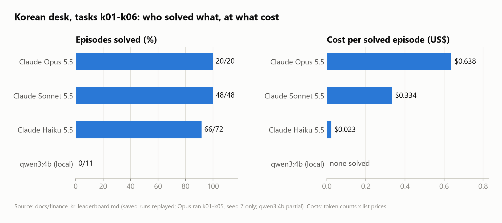
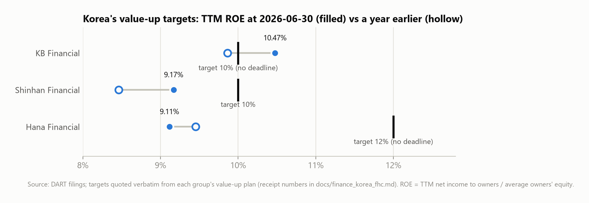
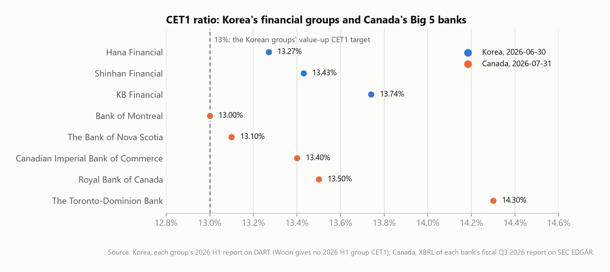

# AI analyst agents on bank filings: Korea and Canada

AgentWorld-Lite is a small testbed for multi-agent LLM collaboration. Its finance domain is a research desk where every
number has to trace back to a regulatory filing. This page explains what was built on that desk for Korea's four largest
financial holding companies and Canada's Big 5 banks, why the two markets sit side by side, and what came out of it.
Everything here can be rerun offline from the repository; the figures in this page come from its committed files.

> Educational project, not investment advice. No ratings, no target prices, no market prices in the comparisons.

## Why Korea and Canada

- **The personal reason.** I am preparing to work in Canada's financial sector. I started where I know the data, with
  Korea's banks on DART, and then applied the same method to Canada's banks on their SEDAR+ filings (read from the
  copies they file on SEC EDGAR). The point is to show that the way of working carries over, not just the code.
- **Comparable banking systems.** In both countries a handful of large banking groups dominate (Korea's four financial
  holding companies, Canada's Big 5), and both report capital under the Basel III framework, so CET1 ratios can stand
  next to each other.
- **Both make public promises.** Korea's groups publish value-up plans (기업가치 제고 계획) with ROE, CET1 and payout
  targets; Canada's banks publish medium-term financial objectives. The aim is to check "promise vs progress" from
  filings alone in both. (The Canadian check, which quotes the objectives from the annual reports, is in progress;
  see below.)
- **Different filing systems.** DART and SEDAR+/EDGAR differ in format, identifiers and amendment practice. If "every
  number cites a filing" holds on both, the method is not tuned to one market.
- **What is not compared.** Share prices and valuation multiples (not verifiable from filings alone; the Korean desk
  ships no prices at all), and ratios whose definitions differ between the markets: Korea's cost-to-income ratio here
  includes credit-loss provisions in the denominator, Canada's efficiency ratio is non-interest expense over revenue.

## The desk

Three agents share a desk: a collector who can fetch filings, an analyst who can calculate, and a reporter who can
submit. Each fact carries an ID; a calculation creates a new fact that records its inputs; the reporter submits fact
IDs, not numbers. Answers must be within 0.1%. Every task comes in two versions, with the sentence that defines the
method either in a document everyone sees or only in the analyst's private brief, and runs with chat on or off. Every
task ships a scripted reference solution that must succeed, and an idle team must fail.

On top of the desk:

- **Value-up check (Korea).** Each group's targets are quoted verbatim from its value-up plan with the DART receipt
  number, and the build refuses to write unless every quote is found in the filed document. Progress is measured from
  filings: TTM ROE, the CET1 ratio each group printed in its half-year report, payout from the dividend and
  buyback-decision APIs, the share count.
- **AI report and fact-check.** The same question went to Claude Opus 5.5 twice, without data and with a 289-fact data
  pack that requires a citation after every figure. A rule-based checker (no model) recomputes every citation and
  matches every figure's context against 675 values computed from the filings; a separate filing-checker tool confirmed
  the net-income claims.
- **Leaderboard.** Saved runs are replayed on a fresh desk; every wrong or missing answer is placed either at a named
  mistake (a catalog of 98) or at the collaboration step that failed.
- **Earnings reviewers.** For each group's latest report: the quarter alone from cumulative reports, a variance table,
  capital, model QC and a cited draft staged for human review. Korea (Korean, DART) and Canada (English, EDGAR). The
  workflow follows the Earnings Reviewer agent in Anthropic's
  [financial-services](https://github.com/anthropics/financial-services) repository, on filings only.
- **Filings watcher.** Finds new or amended periodic reports on DART; adds only new periods, never commits or pushes.

## What came out of it

### Small models solve it; failures are coordination, not arithmetic



151 saved episodes on six task pairs: Opus 5.5 20/20 (five pairs, one seed), Sonnet 5.5 48/48, Haiku 5.5 66/72 at
about a fifteenth of Sonnet's cost per solved episode, and a local qwen3:4b 0/11 (81% of its turns made no tool call).

No model ever submitted a wrong number, and no intermediate calculation hit any of the 98 listed mistakes (period-end
instead of average equity, annualizing a half year, a half-year figure where a quarter was asked, and so on). All six Haiku failures
came from one setting: the method was written only in the analyst's private brief and chat was blocked, so the
analyst could not ask the collector for the inputs only it knew were needed (credit-loss provisions for a
cost-to-income ratio, mid-year equity for an average-equity ROE). The traps did not separate these models; the
placement of information did.

### Without data the model declined to invent; with data it checked out

Asked for a report on the four Korean groups' Q2 2026 results with no data, Opus 5.5 wrote "needs checking" 53 times
and invented no 2026 figure; the targets it remembered were partly out of date. Given the cited data pack, 60 of its 61
figures matched the filings (the 61st was a threshold statement with nothing to check), and all 46 citations
recomputed. The first data-pack answer had stopped at an 8,000-token output cap; asked again with 20,000 tokens it
finished. Three calls cost US$0.77. The checker's rules were tuned on these two answers, so its accuracy on other
text is unproven.

### Korea's value-up promises, checked against filings



KB Financial meets its ROE target (10.47% against 10%) and its CET1 target. Shinhan is on track for ROE 10% by 2027
(9.17%, up 0.71 pp in a year against 0.55 pp a year needed) but behind on cutting its share count. Hana is at 9.11%
against a 12% target with no deadline, and its ROE fell over the year. Woori's targets appear only in an attachment
DART's API does not serve, so they are not quoted.

### Capital in both markets



All eight sit between 13.0% and 14.3%: the Korean groups at the end of June 2026 (as printed in their half-year
reports), the Canadian banks at the end of July 2026 (their fiscal Q3 XBRL). Both report under Basel III, but national
rules and the reporting dates differ, so this is a level check, not a ranking.

### What the earnings reviewers flagged for a human

- **BMO, fiscal Q3 2026:** net income to common down 33% from the previous quarter; the quarter includes a C$962M
  goodwill charge.
- **KB Financial and Shinhan, Q2 2026:** fee income up 55% and 56% from a year earlier, with the same XBRL concept in
  both years, so a real move or a company reclassification, not a mapping error.

### Canada's medium-term objectives

In progress: the same promise-versus-progress check for the Big 5, with each bank's objectives quoted from its fiscal
2025 annual report and verified against the filed document.

## Limits

Small numbers of episodes and seeds (Opus ran one seed); costs are token counts times list prices; figures are as
filed, with no adjustment for one-off items; the fact-check rules were tuned on the answers they report on; the CET1
comparison mixes two reporting dates.

## Try it

```bash
pip install -e ".[dev]"
python -m pytest -q
streamlit run demo/streamlit_app.py
```

No API key is needed for the tests or the demos. Korean details: [finance_korea_fhc.md](finance_korea_fhc.md);
Canadian details: [finance_canada.md](finance_canada.md); model comparison: [finance_kr_leaderboard.md](finance_kr_leaderboard.md);
deploying the demos: [deploy_demo.md](deploy_demo.md). Charts: `python demo/make_charts.py`.
